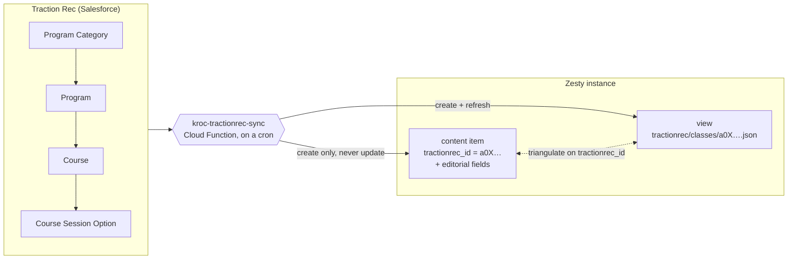
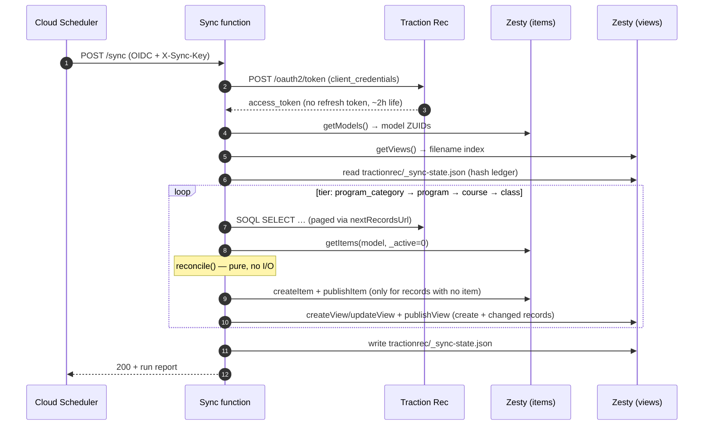
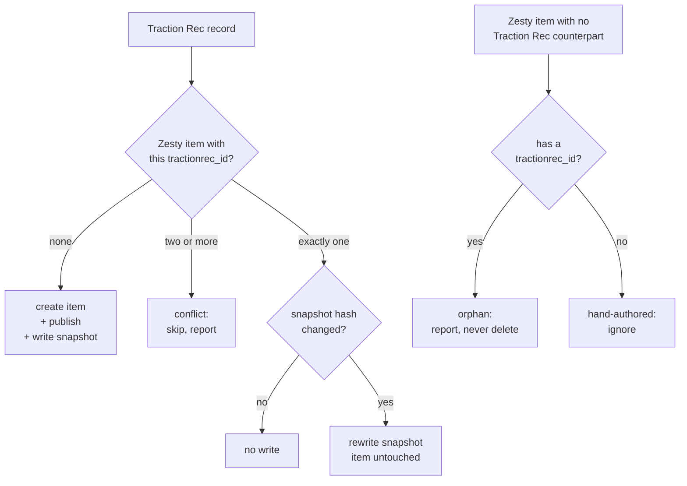

# Sync flow

> How one run of `kroc-tractionrec-sync` works, and why it makes the choices it
> makes. Companion documents: [data-mapping.md](data-mapping.md) for the field
> tables, [operations.md](operations.md) for deploying and running it.

---

## 1. The shape of the thing

Traction Rec is the system of record for the catalog. Zesty owns the URLs, the
page layouts and everything an editor writes. The service is the one-way bridge
between them, and it keeps the two concerns in two separate places:

Written per run: one snapshot per record at `/tractionrec/<tier>/<trId>.json`,
**plus one file per tier** at `/tractionrec/<tier>.json` holding every record —
that is what lets a consumer answer "which courses are in this program" in a
single request, since each record already carries its own parent — **plus one
children file per parent** at `/tractionrec/<parentTier>/<parentId>/<childTier>.json`
holding only that parent's children, so a page can skip the tier file
entirely. Tier and children files are derived from the same rows in the same
run, and are rewritten only when their content changes. See
[relationships-without-zesty-fields.md §2.0c](relationships-without-zesty-fields.md).

| Concern | Lives in | Written by |
| :--- | :--- | :--- |
| Traction Rec data (schedule, capacity, price, register link) | a JSON view at `tractionrec/<tier>/<trId>.json` | **this service only** |
| Editorial content (hero image, body copy, SEO, URL) | the Zesty content item | **editors only** |
| The join between them | the `tractionrec_id` field on the item | this service, on create |

An item and its snapshot are two halves of one class. The `tractionrec_id`
field is the hinge: given an item you can compute the snapshot's URL, and the
snapshot records the item's ZUID so the trip works in both directions.

**Why the item is never updated after creation.** The item is the editable
surface. If the service wrote item fields on every run, every sync would
silently revert whatever an editor changed since the last one — and it would do
so at 3am, with no diff anyone would read. So the service seeds an item once,
with only the fields an editor cannot supply (the join key, a title, the parent
link), and after that it only ever touches the snapshot file.

---

## 2. One run, end to end

Tiers run **in dependency order**, because a child's item needs its parent's
ZUID to exist before it can link to it. A child whose parent is missing is
skipped and logged rather than created at the root — an item created in the
wrong place takes a URL that contradicts the catalog's route shape, and moving
it later is manual work.

---

## 3. The reconcile decision table

This is the part that answers *"what happens when Traction Rec has nine
categories and Zesty has six?"* It lives in
[`src/sync/reconcile.js`](../src/sync/reconcile.js) as a pure function with no
network access, which is why [`test/reconcile.test.js`](../test/reconcile.test.js)
can assert the whole table directly.

| Traction Rec record | Matching Zesty item | Outcome |
| :--- | :--- | :--- |
| present | none | **CREATE** the item (seeded + published), then write the snapshot — see §3.1 |
| present | one, snapshot hash differs | **REFRESH** the snapshot. The item is not touched |
| present | one, snapshot hash matches | **NOTHING** — no write, no new version |
| present | two or more with the same id | **CONFLICT** — skip both, report. Writing either one would be a guess |
| absent | present, has a `tractionrec_id` | **ORPHAN** — report only. Never deleted |
| absent | present, no `tractionrec_id` | **UNLINKED** — a hand-authored page. Ignored entirely |

### 3.1 What a created item is seeded with

Three sources, in descending precedence ([`src/sync/seed.js`](../src/sync/seed.js)):

1. **Identity** — `tractionrec_id`, the title, the parent link. The service
   owns these and nothing overrides them.
2. **Traction Rec** — fields the tier declares in `zestyFieldsFromTr`, where a
   Zesty field and a Traction Rec field genuinely mean the same thing. On
   `[classes]` that is most of the card: dates, days, times, age range,
   instructor, register link. On `[categories]` it is nothing at all, because
   Traction Rec's category descriptions are empty on all 9 records.
3. **A seed template** — values copied from an existing hand-made item, used
   *only* for fields the model marks required that neither of the above filled.

**Source 3 is scaffolding, not architecture.** Zesty enforces `required` on
create and the service cannot invent a hero image, so without it no item can be
created at all. It is deliberately confined to required fields — never an
optional one — so machine-written values stay on the smallest possible surface
and are obvious when an editor opens the item. Configure it with
`SEED_TEMPLATE_ITEMS=program_category:7-…`; the run logs a warning whenever it
is used, and the report's `provenance` says which fields came from where.

The real fix is clearing `required` on editorial fields — see §7. Until then,
every item created this way carries a placeholder icon and subtitle that
someone has to replace by hand.

### No automatic deletion

Deletion is deliberately absent, and not just as a safety default. A class
disappearing from Traction Rec between seasons is *normal*, and its Zesty item
may carry hand-written copy, an uploaded hero image and a URL that is indexed
and linked. Removing all of that on a schedule, because a season rolled over,
is a decision for a person. Orphans surface in the run report; acting on them
is a manual step.

There is one refinement. The class tier queries with a `WHERE` clause —
Traction Rec's own publishing gate — so a class that merely *stopped being
publishable* looks exactly like one that was deleted. Reporting the entire back
catalogue as orphaned every season would train everyone to ignore the report,
so `orphansAreMeaningful()` suppresses orphan reporting for any tier that was
fetched with a filter, and counts them under `orphansSuppressed` instead.

### Conflicts

Two items carrying the same `tractionrec_id` is a data error — usually a
duplicated item in the Manager, exactly the way `membership_family_play_comparison`
picked up a *"… (copy)"* variant. The service refuses to pick one. Both ZUIDs
go in the report so a human can delete the wrong one.

---

## 4. Change detection

Each snapshot carries `meta.hash`, a SHA-256 over the record's **values** —
canonicalised with sorted keys, so a reordering by Salesforce is not a change.
`meta.syncedAt` is deliberately *outside* the hash.

That one detail is what makes a frequent cron affordable. Without it, every run
rewrites ~1,000 views, each write creates a new version, and the Manager's
version history becomes unusable within a week. With it, a run that finds
nothing changed performs zero writes.

The previous run's hashes live in `tractionrec/_sync-state.json` — one more
`ajax-json` view in the same folder. Keeping the ledger in the instance avoids
adding Firestore or GCS as a third dependency, and makes the state inspectable
in a browser. It holds ids, hashes and counts; nothing secret. If it is lost,
the next run rewrites every snapshot once and carries on.

---

## 5. Two hazards specific to writing views

**Parsley parses view source, including inside strings.** A Zesty view is a
template, not a static file, and a literal double-open-curly is evaluated as
markup *wherever it appears* — a stray one inside a JS comment in `loader` took
down every page on the instance on 2026-09-18. Traction Rec rich-text is
hand-pasted HTML, so this is a live risk, not a theoretical one.
`parsleySafeJson()` rewrites the sequence to `{{`: a JSON parser
resolves it back to the original characters, and Parsley only ever sees six
harmless ones.

**Path parts are unique within a parent scope, and nothing is nested.**
Categories, programs, courses and classes all sit at root, so all four compete
for one namespace and a duplicate is a hard 400 at create. Three real
collisions on the first live run: the Boxing *category* and the Boxing
*program* both wanted `/boxing/`, the same for `senior-activities`, and two
programs each had a course called "4-6 Age Division". `uniquePathPart()`
resolves these by preferring the parent's path as a prefix — `sports-boxing`,
`soccer-4-6-age-division` — which says something true about where the item
sits, falling back to a numeric suffix. Nesting items under their parent would
remove the collision structurally by giving each parent its own namespace;
that is a URL-architecture decision, not a sync one.

**Parsley can render Traction Rec data server-side, three ways with different
limits — including one that makes real HTTP calls.** `api.json.get(url)`
fetches any URL, external domains included, and iterates it: so the claim that
Parsley has no outbound HTTP is **wrong** (corrected 2026-09-30). It still
cannot reach Traction Rec — no headers, GET-only, and a view is public — so the
proxy remains mandatory, but the reason changed. Fetched JSON must be a root
array of **flat** rows: reading a nested-object value crashes the page, a dead
URL renders empty with no error, and `where` is silently ignored.

**The other two, with narrower limits:** `{{ include }}` inlines a snapshot file — path interpolation works
for `{this.*}` and `{get_var.*}` but not loop aliases or `$` variables, and a
missing file renders empty rather than erroring. `json()` walks JSON held in a
content **field**: a top-level array iterates, nested arrays do not, dotted
scalars work, and a `where` clause on such a loop is **silently ignored**. The
two do not compose — `json()` cannot parse what `include` inlines. Tested
2026-09-30; this is the basis of
[relationships-without-zesty-fields.md](relationships-without-zesty-fields.md).

**A view's filename needs a leading slash.** Every `ajax-json` view that
serves on the live domain has one. A view created as `tractionrec/x.json` is
accepted by the API, reports `status: live`, appears correctly in the Manager —
and 404s on every request. Verified the hard way on 2026-09-25; `viewPath()`
now normalises both the paths written and the index they are looked up in, so
a lookup cannot miss on the form of the string alone.

**A view must be published to answer on the live domain.** An unpublished view
exists in the Manager and 404s on the site — which would be exactly the files
this service exists to produce. Every create and update is followed by a
`publishView`.

---

## 6. The freshness trade-off — read this before scheduling

`tractionrec-integration-spec.md` §3.1 recorded that five fields must **not**
be stored: availability, spots remaining, capacity, price and the deep link.
The reasoning stands: a cached "3 spots left" that tells a parent a full class
is open is worse than no number at all.

This service stores them. That is a real change of position, and it is only
defensible with the cadence made explicit: **a snapshot is as fresh as the
cron, and no fresher.** Whatever interval Cloud Scheduler runs at is the
maximum age of every number on the site.

Three ways to live with it, in ascending cost:

1. **Don't render the volatile numbers from the snapshot.** Show schedule,
   ages, instructor and price from the file; render the register button as a
   plain link to `registerUrl` and let Traction Rec's own page state capacity.
   Costs nothing and removes the problem entirely.
2. **Run the class tier on a short cycle** (5–15 min) and the upper three
   daily. They change on completely different timescales — categories and
   programs move a few times a year. `?tiers=classes` exists for this.
3. **Add a live read-through endpoint** on this same service for the class
   detail page, and let the snapshot serve only the listing pages. This is the
   original "fetch live and merge at runtime" design, narrowed to the one page
   where the number actually drives a decision.

Option 1 is the recommendation until someone asks for a live spot count.

---

## 7. What has to exist before the first run

### Per tier, as of 2026-09-28

| | `tractionrec_id` | Required fields the service cannot supply | Seed template needed |
| :--- | :--- | :--- | :--- |
| `categories` | ✅ present | `category_icon`, `hero_image_desktop`, `hero_subtitle` | yes — **synced, 9 items live** |
| `programs` | ❌ **missing** | `hero_image_desktop` | yes |
| `courses` | ❌ **missing** | *none* — `course_name` is the only required field and the service supplies it | **no** |
| `classes` | ❌ **missing** | `class_type` (dropdown), `hero_image_desktop` | yes |

- [ ] **Add `tractionrec_id` (Single Line Text) to `programs`, `courses` and
      `classes`.** Nothing runs without it. `categories` already has it.

- [ ] **Clear the `required` flag on editorial fields, or point a seed template
      at an existing item.** Zesty enforces required fields on create and the
      service cannot invent a hero image. Each of the three models has exactly
      one hand-authored item usable as a template:
      `program:7-ac9ad7d4e3-zfqr4q`, `course:7-b4d5d7c2fa-s3w9mw`,
      `class:7-ec96ebc6e2-4wr4g5`. Those items carry full prototype copy, but
      the template only ever fills *required* fields, so at most an image ZUID
      and `class_type: "roster"` are copied — none of the prose.

- [ ] **Accept or fix the 3 records with no parent.** 2 of 22 Programs carry no
      Program Category Tag (`Kickball`, `Corps Programs for Registration`) and
      are skipped, which cascades to 1 Course. No classes are lost. Tagging
      them in Traction Rec is the fix; skipping is the safe default.

- [ ] Decide whether snapshot views should sync back into the
      `Kroc-Center-Template` repo. They are views, so the Zesty VS Code
      extension will pull them down — ~1,000 machine-generated JSON files
      landing next to hand-written ones. Excluding `webengine/views/tractionrec/`
      from the sync is probably what you want.
- [ ] Decide what happens to the five volatile fields already modelled on
      `[classes]` — `enrollment_status`, `spots_remaining`, `member_price`,
      `public_price`, `deep_link_url`. They now have two sources: the Zesty
      field an editor can type into, and the snapshot. `class-finder.json`
      currently reads the Zesty fields. Two sources for one number is how a
      site starts contradicting itself; pick one and change the endpoint.

- [ ] Get the org's daily API request budget from the Traction Rec admin.
      `/limits` is disabled for this integration user, so the ceiling is
      currently unknown and the cron interval is a guess until it is not.
