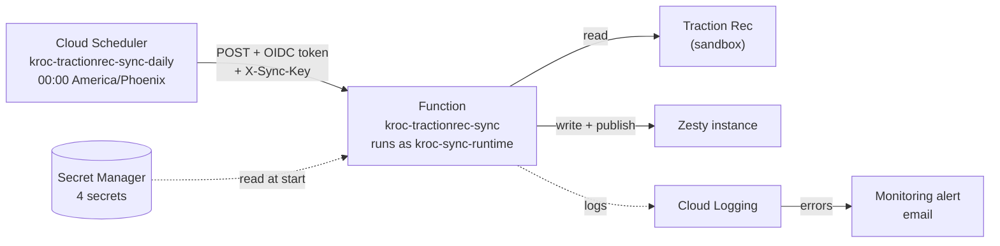

# Deploying the sync

The sync runs as an HTTP function in Google Cloud (Cloud Run functions, 2nd
gen). Cloud Scheduler calls it once a day, and Cloud Monitoring emails when a
run goes wrong. One script sets all of that up and is safe to rerun:

```bash
bash deploy/deploy.sh
```



## What's deployed today

| | |
| --- | --- |
| Project | `kroc-services` (number 1029593951118), region `us-west1` |
| Function | `kroc-tractionrec-sync`: `https://us-west1-kroc-services.cloudfunctions.net/kroc-tractionrec-sync` |
| Schedule | `kroc-tractionrec-sync-daily`, every day at 00:00 America/Phoenix |
| Alert email | japhethlouie@gmail.com |

All of these names and settings live in [config.sh](config.sh).

## Before the first deploy

You need, on the machine you deploy from:

1. **The gcloud CLI**, signed in to an account with access to the project:
   ```bash
   gcloud auth login
   gcloud config set project kroc-services
   ```
   Owner on the project covers everything. Without Owner, the account needs:
   Service Usage Admin, Service Account Admin, Service Account User,
   Secret Manager Admin, Cloud Functions Admin, Cloud Run Admin, Cloud
   Scheduler Admin and Monitoring Editor.
2. **`node`, `git`, `curl` and `openssl`.**
3. **A filled-in `.env`** in the repo root. Copy `.env.example` and fill in the
   Traction Rec client id and secret and the Zesty instance token.
   `SYNC_TRIGGER_KEY` can stay empty: the first deploy generates one.

## Deploy

```bash
bash deploy/deploy.sh                  # every step, in order
bash deploy/deploy.sh function check   # only these steps
```

| Step | What it does |
| --- | --- |
| `apis` | Turns on the Google Cloud products the sync uses. A new project has them off. |
| `accounts` | Creates two service accounts: `kroc-sync-runtime`, which the function runs as and which can only read its secrets, and `kroc-sync-scheduler`, which Cloud Scheduler uses to call the function. |
| `secrets` | Copies the four secrets from `.env` into Secret Manager ([secrets.sh](secrets.sh)). Existing secrets are left alone. |
| `function` | Uploads this folder and deploys it. Takes about 1.5 minutes. |
| `invoker` | Lets only `kroc-sync-scheduler` call the function. |
| `schedule` | Creates or updates the daily Cloud Scheduler job. |
| `alerts` | Creates the error email ([alerts.sh](alerts.sh)), once. |
| `check` | Calls the function as you with `?dry=1`: a full run that writes nothing. Fails unless it returns 0 errors. |

Each step looks at what exists and only creates or changes what's missing or
different. A full rerun is therefore safe, and it's also how you'd set the
whole thing up in a new project: change `PROJECT` in `config.sh` (or
`PROJECT=… bash deploy/deploy.sh`) and run it.

## Common tasks

| Task | Command |
| --- | --- |
| Deploy a code change | `bash deploy/deploy.sh function check` |
| Run the sync now | `gcloud scheduler jobs run kroc-tractionrec-sync-daily --location=us-west1` |
| Change the time | edit `SCHEDULE` / `TIME_ZONE` in `config.sh`, then `bash deploy/deploy.sh schedule` |
| New Traction Rec or Zesty credentials | update `.env`, then `bash deploy/secrets.sh --rotate && bash deploy/deploy.sh function schedule check` |
| New trigger key | empty `SYNC_TRIGGER_KEY` in `.env`, then the same command as above (it generates one) |
| Pause / resume the daily run | `gcloud scheduler jobs pause kroc-tractionrec-sync-daily --location=us-west1` (`resume` to restart) |
| Read the last runs | `gcloud logging read 'resource.labels.service_name="kroc-tractionrec-sync" AND jsonPayload.message="sync.done"' --limit=5 --format='value(timestamp,jsonPayload.errorCount,jsonPayload.durationMs)'` |
| Roll back | check out the previous commit, then `bash deploy/deploy.sh function check` |
| Switch Traction Rec to production | change `TR_LOGIN_URL` in `config.sh`, put the production credentials in `.env`, then the "new credentials" command. Every Salesforce Id changes, so the datasets need a clean rebuild first (see [AGENTS.md](../AGENTS.md) §8). |

## Things that matter

- **The function step uploads this folder as it is on disk**, including
  uncommitted changes (the script warns when there are any). Deploy from a
  clean checkout of `main`. [.gcloudignore](../.gcloudignore) limits the upload
  to `src/`, `zesty-models/` and the package files; `.env` is never uploaded.
- **`DRY_RUN=0` is set by the deploy.** The code defaults to a dry run, so a
  function deployed without it would look healthy and write nothing.
- **One instance, one request at a time** (`--max-instances=1 --concurrency=1`).
  The code has no lock, and two overlapping runs could create the same item
  twice.
- **Two locks on the function.** A caller needs a Google identity that is
  allowed to call it *and* the `X-Sync-Key` header. Either one missing gets a
  403.
- **Secrets are never printed.** The schedule step does pass the trigger key
  to gcloud as an argument, so run it on a machine you trust.
- **An error alert** fires on a run with errors, a failed run, any ERROR log
  line, or a failed Scheduler call. At most one email per 5 minutes.

## Why `gcloud functions deploy`

The script deploys with `gcloud functions deploy --gen2`, which uses the Cloud
Functions v2 API. Google still supports this and has not deprecated it, but
its docs now recommend the Cloud Run Admin API (`gcloud run deploy
--function`) for new functions. Both produce the same thing underneath: a 2nd
gen function is a Cloud Run service. This one keeps the Functions command for
two reasons:

- the function was created through the Functions API, and Google's docs say a
  function created through the Cloud Run Admin API can't be changed through the
  Functions API, so mixing the two is a one-way switch;
- the Functions API also gives the function its `cloudfunctions.net` address.

If the project moves to `gcloud run deploy`, change the `function` and
`invoker` steps together, and redeploy the Scheduler job afterwards
(`schedule`), because it reads the function's address from the Functions API.
