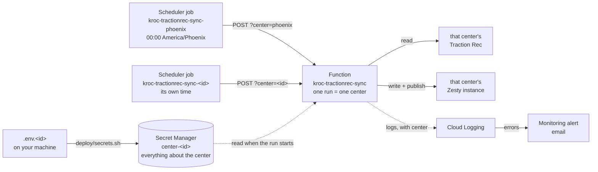

# Deploying the sync

The sync runs as one HTTP function in Google Cloud (Cloud Run functions, 2nd
gen) that serves every Kroc center. Each center has its own Traction Rec org,
its own Zesty instance and its own Cloud Scheduler job, which calls the
function once a day for that center. Cloud Monitoring emails when a run goes
wrong. One script sets all of that up and is safe to rerun:

```bash
bash deploy/deploy.sh
```



Every call carries an OIDC identity token and the `X-Sync-Key` header; the
function refuses a call missing either one.

## What's deployed today

| | |
| --- | --- |
| Project | `kroc-services` (number 1029593951118), region `us-west1` |
| Function | `kroc-tractionrec-sync`: `https://us-west1-kroc-services.cloudfunctions.net/kroc-tractionrec-sync` |
| Centers | `phoenix` (00:00 America/Phoenix) and `phoenix-2` (00:30 America/Los_Angeles), a test copy of Phoenix with the same org and instance |
| Alert email | the `ALERT_EMAIL` in [config.sh](config.sh) |

Shared names and settings are in [config.sh](config.sh). Everything about a
center is in its `.env.<id>` file on your machine and its `center-<id>` secret
in Secret Manager.

## A center

Everything about a center is one file, **`.env.<id>`**, in the repo root
(gitignored). `<id>` is lowercase letters, digits and hyphens; copy the
template [.env.center.example](../.env.center.example):

```
CENTER_NAME=Kroc Center Phoenix
TR_LOGIN_URL=https://krocphoenix--phoenixfsb.sandbox.my.salesforce.com
TR_API_VERSION=v62.0
TR_CLIENT_ID=…
TR_CLIENT_SECRET=…
ZESTY_INSTANCE_ZUID=8-80c0bba6b8-lhkcc7
ZESTY_INSTANCE_TOKEN=…
SCHEDULE=0 0 * * *
TIME_ZONE=America/Phoenix
```

- A `.env.<id>` counts as a center only when it sets `CENTER_NAME`, so
  `.env.example` and backups are ignored.
- [secrets.sh](secrets.sh) copies the file into Secret Manager as
  **`center-<id>`** (labelled `kroc-sync=center`), and only when the file
  differs from what's there. The function reads that secret at the start of
  each run, so **a new or changed center needs no redeploy**: a center exists
  when its secret does.
- The deploy script lists the centers from Secret Manager, not from your
  files, so the `schedule` and `check` steps work from any machine signed in to
  the project. The file is only needed to create or change a center.
- None of this is in git. Secret Manager keeps every version of a center, so
  its history is there (`gcloud secrets versions list center-<id>`).

The center also needs, outside this repo:

- **A Zesty instance built from the template**, with the nine `tr_*` models
  (created from `zesty-models/` with the site repo's `zesty-model.mjs`), the
  four catalog page models (`categories`, `programs`, `courses`, `classes`)
  with their editorial fields left optional, and the site views. The sync
  checks the models before writing and stops if they don't match.
- **A read-only Traction Rec integration user** in that center's org: a
  connected app with the client-credentials flow, allowed to read the
  `TREX1__…` objects. Check that the org has the fields the sync reads; the
  Register link (`Deep_Link_URL__c`) is a field Phoenix's org added itself.

### Adding a center

```bash
cp .env.center.example .env.<id>   # fill it in; pick the center's own time zone
npm run sync:dry -- --center=<id> --summary   # locally: plans, writes nothing

bash deploy/secrets.sh <id>                   # its secret
bash deploy/deploy.sh schedule check          # its job, and a dry run over HTTP
```

No function redeploy. The first live run for a new instance creates every
item and page, which takes a few minutes; to watch it, run the job by hand
(below).

### Removing a center

Nothing in the scripts deletes, so remove its job and its secret by hand,
then its file:

```bash
gcloud scheduler jobs delete kroc-tractionrec-sync-<id> --location=us-west1
gcloud secrets delete center-<id>
rm .env.<id>
```

The function answers that center with 404 from then on.

## Before the first deploy

You need, on the machine you deploy from:

1. **The gcloud CLI**, signed in to an account with access to the project:
   ```bash
   gcloud auth login
   gcloud config set project kroc-services
   ```
   Owner on the project covers everything. Without Owner, the account needs:
   Service Usage Admin, Service Account Admin, Service Account User,
   Secret Manager Admin, Cloud Functions Admin, Cloud Run Admin, Cloud
   Scheduler Admin and Monitoring Editor.
2. **`node`, `git`, `curl` and `openssl`.**
3. **A `.env.<id>` for each center** whose secret isn't in Secret Manager yet
   (a center already there needs no file).
   `SYNC_TRIGGER_KEY` in `.env` can stay empty: the first deploy generates one.

## Deploy

```bash
bash deploy/deploy.sh                  # every step, in order
bash deploy/deploy.sh function check   # only these steps
```

| Step | What it does |
| --- | --- |
| `apis` | Turns on the Google Cloud products the sync uses. A new project has them off. |
| `accounts` | Creates two service accounts: `kroc-sync-runtime`, which the function runs as and which can only read its secrets, and `kroc-sync-scheduler`, which the Scheduler jobs use to call the function. |
| `secrets` | Creates the trigger key if missing, and uploads every `.env.<id>` on this machine to its `center-<id>` secret when it differs ([secrets.sh](secrets.sh)). |
| `function` | Uploads this folder and deploys it. Takes about 1.5 minutes. |
| `invoker` | Lets only `kroc-sync-scheduler` call the function. |
| `schedule` | Creates or updates one daily job per center secret, `kroc-tractionrec-sync-<id>`, at its `SCHEDULE` and `TIME_ZONE`. Reports a job that matches no center; never deletes one. |
| `alerts` | Creates or updates the error email ([alerts.sh](alerts.sh)). |
| `check` | Calls the function as you with `?center=<id>&dry=1` for every center: full runs that write nothing. Fails unless each returns 0 errors. |

Each step looks at what exists and only creates or changes what's missing or
different. A full rerun is therefore safe, and it's also how you'd set the
whole thing up in a new project: change `PROJECT` in `config.sh` (or
`PROJECT=… bash deploy/deploy.sh`) and run it.

## Common tasks

| Task | Command |
| --- | --- |
| Deploy a code change | `bash deploy/deploy.sh function check` |
| Run one center now | `gcloud scheduler jobs run kroc-tractionrec-sync-<id> --location=us-west1` |
| Change a center's time | edit `SCHEDULE` / `TIME_ZONE` in `.env.<id>`, then `bash deploy/secrets.sh <id> && bash deploy/deploy.sh schedule` |
| New credentials for a center | update `.env.<id>`, then `bash deploy/secrets.sh <id>`. The next run uses them; nothing to redeploy. |
| New trigger key | empty `SYNC_TRIGGER_KEY` in `.env`, then `bash deploy/secrets.sh --rotate-key && bash deploy/deploy.sh function schedule check` (the function and every job must get it together, or calls get 403) |
| Pause / resume a center | `gcloud scheduler jobs pause kroc-tractionrec-sync-<id> --location=us-west1` (`resume` to restart) |
| Read a center's last runs | `gcloud logging read 'resource.labels.service_name="kroc-tractionrec-sync" AND jsonPayload.message="sync.done" AND jsonPayload.center="<id>"' --limit=5 --format='value(timestamp,jsonPayload.errorCount,jsonPayload.durationMs)'` |
| Roll back | check out the previous commit, then `bash deploy/deploy.sh function check` |
| Switch a center to production Traction Rec | change `TR_LOGIN_URL` and the client id + secret in its `.env.<id>`, then `bash deploy/secrets.sh <id> && bash deploy/deploy.sh check`. Every Salesforce Id changes, so its datasets need a clean rebuild first (see [AGENTS.md](../AGENTS.md) §8). |

`secrets.sh` without ids uploads every center file on this machine; a center
without its file here keeps its secret. It never changes the trigger key;
that's `--rotate-key`.

## Things that matter

- **The function step uploads this folder as it is on disk**, including
  uncommitted changes (the script warns when there are any). Deploy from a
  clean checkout of `main`. [.gcloudignore](../.gcloudignore) limits the upload
  to `src/`, `zesty-models/` and the package files; `.env` and `.env.<id>`
  are never uploaded.
- **`DRY_RUN=0` is set by the deploy.** The code defaults to a dry run, so a
  function deployed without it would look healthy and write nothing.
- **One request at a time** (`--max-instances=1 --concurrency=1`). The code
  has no lock, and two overlapping runs of the same center could create the
  same item twice. A call that arrives during another run waits for it; in a
  test, two centers fired together both finished with 200. Give centers
  different start times anyway.
- **Two locks on the function.** A caller needs a Google identity that is
  allowed to call it *and* the `X-Sync-Key` header. Either one missing gets a
  403. A call without `?center=` gets 400, an unknown center 404.
- **Secrets are never printed.** The schedule step does pass the trigger key
  to gcloud as an argument, so run it on a machine you trust.
- **An error alert** fires for any center on a run with errors, a failed run,
  any ERROR log line, or a failed Scheduler call. Every log line carries the
  center id, so the log entry in the email names the center. At most one email
  per 5 minutes.

## Why `gcloud functions deploy`

The script deploys with `gcloud functions deploy --gen2`, which uses the Cloud
Functions v2 API. Google still supports this and has not deprecated it, but
its docs now recommend the Cloud Run Admin API (`gcloud run deploy
--function`) for new functions. Both produce the same thing underneath: a 2nd
gen function is a Cloud Run service. This one keeps the Functions command for
two reasons:

- the function was created through the Functions API, and Google's docs say a
  function created through the Cloud Run Admin API can't be changed through the
  Functions API, so mixing the two is a one-way switch;
- the Functions API also gives the function its `cloudfunctions.net` address.

If the project moves to `gcloud run deploy`, change the `function` and
`invoker` steps together, and redeploy the Scheduler jobs afterwards
(`schedule`), because they read the function's address from the Functions API.
