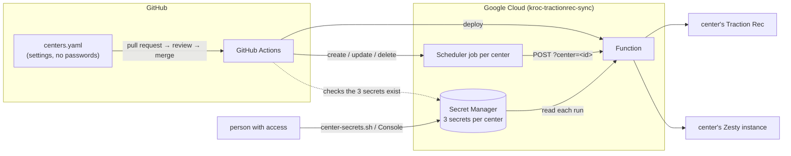

# Deploying the sync

The sync runs as one HTTP function in Google Cloud (Cloud Run functions, 2nd
gen) that serves every Kroc center. Each center has its own Traction Rec org,
its own Zesty instance and its own Cloud Scheduler job, which calls the
function once a day for that center.

- **Settings** (which org, which instance, when) are in
  [centers.yaml](../centers.yaml), reviewed through pull requests.
- **Passwords** are in Secret Manager, three per center, entered directly.
- **Deploying** is merging into `main`: GitHub Actions does the rest.



## What's deployed today

| | |
| --- | --- |
| Project | `kroc-tractionrec-sync` (number 69222274107; moved from `kroc-services` with `deploy/setup.sh --from`), region `us-west1` |
| Function | `kroc-tractionrec-sync`: `https://us-west1-kroc-tractionrec-sync.cloudfunctions.net/kroc-tractionrec-sync` |
| Centers | `phoenix` (00:00 America/Phoenix) and `phoenix-2` (00:30 America/Los_Angeles), a test copy of Phoenix with the same org and instance |
| Deploys | [.github/workflows/deploy.yml](../.github/workflows/deploy.yml): tests on every pull request, deploys on every merge into `main`, into the project in [ci.env](ci.env) |
| Alert email | the `ALERT_EMAIL` in [config.sh](config.sh) |

## A center

**Its settings: an entry in [centers.yaml](../centers.yaml).** The id is the
key: lowercase letters, digits and hyphens.

```yaml
phoenix:
  name: Kroc Center Phoenix
  tractionRec:
    loginUrl: https://krocphoenix--phoenixfsb.sandbox.my.salesforce.com
    apiVersion: v62.0               # optional, default v62.0
  zesty:
    instanceZuid: 8-80c0bba6b8-lhkcc7
  schedule:
    cron: "0 0 * * *"               # in quotes; five fields
    timeZone: America/Phoenix       # IANA name
```

`npm test` checks every entry (known keys only, an https org URL, an instance
ZUID, a five-field cron, a real time zone), so a typo fails the pull request.

**Its passwords: three Secret Manager secrets**, named by a fixed pattern:

| Secret | Holds |
| --- | --- |
| `center-<id>-tr-client-id` | Traction Rec connected app: client id |
| `center-<id>-tr-client-secret` | Traction Rec connected app: client secret |
| `center-<id>-zesty-token` | Zesty instance access token |

Set them with `bash deploy/center-secrets.sh <id>`, which asks for each value
hidden as you type, or in the Cloud Console (Security → Secret Manager →
Create secret). Never in a file. The function reads them by name at the start
of each run, so a new value is used from the next run on, with no deploy. The
function may read any `center-*` secret, so a new center needs no extra grant.

The center also needs, outside this repo:

- **A Zesty instance built from the template**, with the nine `tr_*` models
  (created from `zesty-models/` with the site repo's `zesty-model.mjs`), the
  four catalog page models (`categories`, `programs`, `courses`, `classes`)
  with their editorial fields left optional, and the site views. The sync
  checks the models before writing and stops if they don't match.
- **A read-only Traction Rec integration user** in that center's org: a
  connected app with the client-credentials flow, allowed to read the
  `TREX1__…` objects. Check that the org has the fields the sync reads; the
  Register link (`Deep_Link_URL__c`) is a field Phoenix's org added itself.

## Everyday tasks

| Task | Steps | Reaches Google Cloud |
| --- | --- | --- |
| **Add a center** | 1. `bash deploy/center-secrets.sh <id>` (its three passwords). 2. Pull request adding its entry to `centers.yaml`. 3. Review, merge. | On merge: the deploy checks its secrets, creates its job and dry-runs it. A missing secret stops the deploy and names it. |
| **Change a run time** | Pull request editing its `schedule`; merge. | On merge: the job moves. |
| **New password or token** | `bash deploy/center-secrets.sh <id>` (Enter keeps the others), or a new version in the Console. | The next run uses it. |
| **Point a center at production Traction Rec** | New values for its two Traction Rec secrets, plus a pull request changing its `loginUrl`; merge. | On merge. Every Salesforce Id changes, so its datasets need a clean rebuild first ([AGENTS.md](../AGENTS.md) §8). |
| **Remove a center** | Pull request deleting its entry; merge. Then delete its three secrets. | On merge: its job is deleted. |
| **Code change** | Pull request; review; merge. | On merge: deployed and dry-run for every center. |
| **Run a center now** | `gcloud scheduler jobs run kroc-tractionrec-sync-<id> --location=us-west1`, or "Force run" in the Console. | Immediately. |
| **Pause / resume a center** | `gcloud scheduler jobs pause kroc-tractionrec-sync-<id> --location=us-west1` (`resume`). | Immediately. |
| **Read a center's last runs** | `gcloud logging read 'resource.labels.service_name="kroc-tractionrec-sync" AND jsonPayload.message="sync.done" AND jsonPayload.center="<id>"' --limit=5 --format='value(timestamp,jsonPayload.errorCount,jsonPayload.durationMs)'` | |
| **Roll back** | Revert the commit on `main` (a pull request); merge. | On merge. |

## How a merge deploys

[deploy.yml](../.github/workflows/deploy.yml) runs:

| When | Does |
| --- | --- |
| Every pull request | `npm ci`, `npm test` (including `centers.yaml`), and lists the centers |
| Every merge into `main` (and "Run workflow" on `main`) | the tests, then `bash deploy/deploy.sh verify function schedule check` as the deployer account |

| Step | Does |
| --- | --- |
| `verify` | every center in `centers.yaml` has its three secrets; stops the deploy before anything changes if not |
| `function` | deploys the code, with `centers.yaml`; about 1.5 minutes |
| `schedule` | one job per center at its `schedule`; a job whose center left `centers.yaml` is deleted |
| `check` | a dry run per center over HTTP (`?center=<id>&dry=1`): full runs that write nothing; fails on any error |

**How Actions signs in: Workload Identity Federation.** Google trusts the
tokens GitHub issues to workflows of `TSAUSN/Tractionrec-Sync-Services` on
`main`, and nothing else, and lets them act as `kroc-sync-deployer`. No key is
stored in GitHub. Pull requests, including ones from forks of this public repo,
can't deploy. One deploy runs at a time.

What the deployer may do: deploy the function (with Cloud Run Admin on its one
Cloud Run service, which a deploy needs to keep it private); manage Scheduler jobs; see
that secrets exist (not read them); read the trigger key (the jobs send it);
call the function (the dry runs); act as the accounts the function, its build
and the jobs run as. It can't read a center's passwords.

## Setting up a project: first time, again, or moving

One command, for all three:

```bash
bash deploy/setup.sh                        # set up (or repair) the project in config.sh
bash deploy/setup.sh --from=<old-project>   # move here from another project
```

- **First time:** a new project is empty, so setup builds everything.
- **Again:** every step checks what exists and only fixes what's missing, so
  rerunning it on a working project is safe; use it after a manual change or
  to repair a gap.
- **Moving** to another Google account, project or organization (e.g. off a
  personal account): the same setup in the new project, plus `--from`, which
  copies each center's passwords across and pauses the old project's jobs
  before the new ones start, so no center runs from both.

**What it does, in order:** checks you're signed in and the project and
billing exist → turns on the Google Cloud products → creates the three
accounts, their permissions and the GitHub trust → the trigger key → each
center's passwords (asked for, or copied with `--from`) → deploys the function
→ the permissions that need the function → pauses the old project's jobs
(`--from`) → creates the jobs → dry-runs every center → writes
`deploy/ci.env`, the values GitHub Actions needs. It ends by printing what to
do next.

### Moving to another project or organization, step by step

1. **In the new organization:** create the project and link a billing
   account. Make the person doing the move an **Owner** of it.
2. **On their machine:** `gcloud auth login` with the new account, and give it
   read access to the old project's secrets too (or retype the passwords).
3. **In [config.sh](config.sh):** set `PROJECT` to the new project id, and
   `ALERT_EMAIL` to the address that should get error emails.
4. **Run** `bash deploy/setup.sh --from=<old-project>`.
5. **Commit** `deploy/ci.env` and `deploy/config.sh`, and push to `main`. That
   GitHub deploy signs in to the new project and repeats the checks.
6. **Once it's green,** retire the old project: setup prints the commands
   (its jobs are only paused), or shut the project down.

Nothing about the centers changes: `centers.yaml`, the Zesty instances and
the Traction Rec orgs stay as they are.

**If the new organization has security policies,** an admin may need to allow:
Workload Identity Federation with GitHub as a provider (the `github` step);
the region `us-west1` (else change `REGION` in `config.sh`); an alert email
outside the organization's domain; service account roles granted to the build
account.

**If the GitHub repository moves or is renamed,** set `GITHUB_REPO` in
`config.sh` and run `bash deploy/deploy.sh github`: the trust is tied to the
repository's name.

### Where the project-specific values live

| File | Holds |
| --- | --- |
| [config.sh](config.sh) | `PROJECT`, `REGION`, `ALERT_EMAIL`, `GITHUB_REPO`; everything else derives from these |
| [ci.env](ci.env) | written by setup: the GitHub trust's address, the deploy account, the function's address. The workflow reads it, so the workflow file itself never changes |

Every step can also be run alone, e.g. `bash deploy/deploy.sh check` (dry-run
every center as you) or `bash deploy/deploy.sh ci` (rewrite `ci.env`).

## Things that matter

- **`centers.yaml` is the list.** A center not in it gets 404 from the
  function, and its job is deleted on the next merge.
- **`DRY_RUN=0` is set by the deploy.** The code defaults to a dry run, so a
  function deployed without it would look healthy and write nothing.
- **One request at a time** (`--max-instances=1 --concurrency=1`). The code
  has no lock, and two overlapping runs of the same center could create the
  same item twice. A call that arrives during another run waits for it. Give
  centers different start times anyway.
- **Two locks on the function.** A caller needs a Google identity that is
  allowed to call it *and* the `X-Sync-Key` header. Either one missing gets a
  403. A call without `?center=` gets 400, an unknown center 404.
- **A new trigger key** has to reach the function and every job together:
  `bash deploy/secrets.sh --rotate-key`, then `bash deploy/deploy.sh function
  schedule check` (or a merge). In between, calls get 403.
- **[.gcloudignore](../.gcloudignore)** limits the upload to `src/`,
  `zesty-models/`, `centers.yaml` and the package files. `.env` and the
  credential file the GitHub auth step writes are never uploaded.
- **An error alert** fires for any center on a run with errors, a failed run,
  any ERROR log line, or a failed Scheduler call. Every log line carries the
  center id. At most one email per 5 minutes.

## Why `gcloud functions deploy`

The script deploys with `gcloud functions deploy --gen2`, which uses the Cloud
Functions v2 API. Google still supports this and has not deprecated it, but
its docs now recommend the Cloud Run Admin API (`gcloud run deploy
--function`) for new functions. Both produce the same thing underneath: a 2nd
gen function is a Cloud Run service. This one keeps the Functions command for
two reasons:

- the function was created through the Functions API, and Google's docs say a
  function created through the Cloud Run Admin API can't be changed through the
  Functions API, so mixing the two is a one-way switch;
- the Functions API also gives the function its `cloudfunctions.net` address.

If the project moves to `gcloud run deploy`, change the `function` and
`invoker` steps together, and redeploy the Scheduler jobs afterwards
(`schedule`), because they read the function's address from the Functions API.
